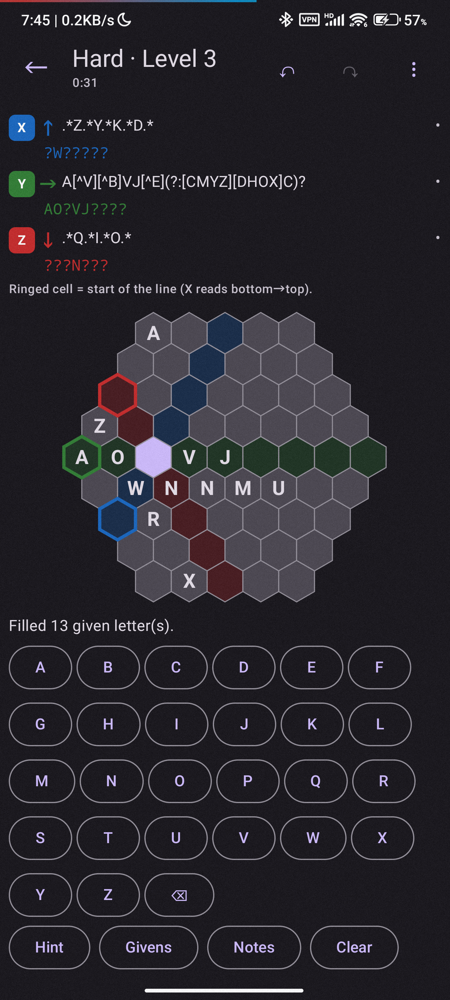

# Regex Crossword

  
  

An offline regex crossword game for Android. Every line in the grid is a
regular expression; fill the cells so the whole word on each line matches its
clue. Hexagon boards read in three directions (X, Y, Z). The easy rectangle
board reads in two (rows and columns).

The application is under `android/`. A python reference implementation is under
[`hexregex/`](hexregex/README.md). It is where the app's Kotlin engine was ported
from; it is used to design and check the algorithms and to generate test
fixtures.

## Android app

- Three difficulties: **Easy** is a rectangle, **Medium** and **Hard** are
  hexagons.
- Easy and Medium are generated on device from the level seed. They are fast
  and can have more than one valid grid.
- Hard puzzles have exactly one solution. They ship as a pre-generated bank so
  they are ready immediately, and the app fills in more in the background.
- On-screen A–Z keyboard, pencil notes, per-cell hints, givens (letters a clue
  writes out literally), undo/redo, and a per-level timer.
- The grid is judged line by line with whole-string regex matching.
- Progress is saved locally for each level.
- No accounts, ads, network access, or permissions.

APKs are on the [releases page](https://github.com/CuSO4Deposit/regex-crossword/releases).
Build and install notes live in [`android/README.md`](android/README.md). The
current app version and supported Android range are in
[`android/app/build.gradle.kts`](android/app/build.gradle.kts).

## Documentation

Architecture, generation, and solving notes are in [`docs/`](docs/). Release
notes are in [`CHANGELOG.md`](CHANGELOG.md).

## Contributing

See [CONTRIBUTING.md](CONTRIBUTING.md) for build and test commands.

## License

MIT — see [LICENSE](LICENSE).

The hexagonal "A Regular Crossword" form was
popularised by Dan Gulotta (based on an idea by Palmer Mebane) in MIT Mystery
Hunt 2013. This project is an independent implementation and includes neither
the original puzzle nor its text.

Source: <https://github.com/CuSO4Deposit/regex-crossword>
